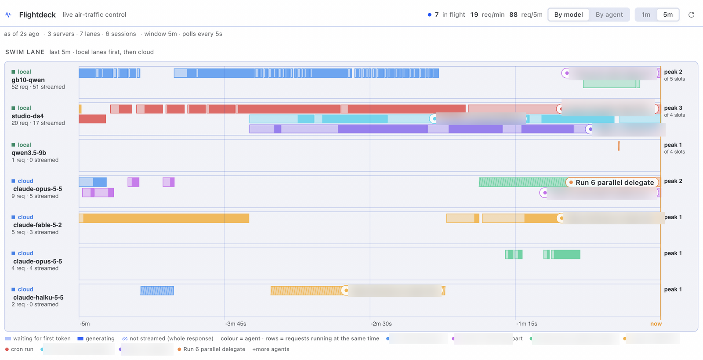
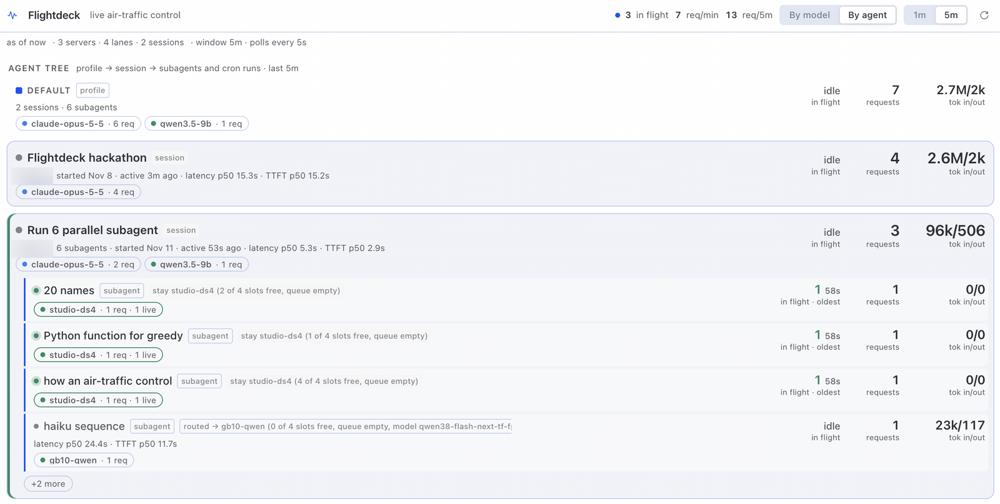

# Flightdeck

Live air-traffic control for Hermes agents and model servers: see every in-flight LLM
request, which profile/session/subagent/cron job holds it, and how loaded each local model
server is (slots in use, queue, prefill/decode tok/s, time to first token) — by agent and by
model.

Flightdeck is a Hermes plugin: observer hooks write request rows to one shared local SQLite
store, a poller reads each configured model server's metrics, and the Desktop plugin renders
the fleet. `fleet_status` lets an agent pick a lane with free capacity.

token-lens tells you what a request cost; Flightdeck tells you which server slot it occupied,
who is waiting for it, and which agent is holding it.

## What you see



**By model.** Local server cards first, one per probed server:

- Slots in use and queue depth, with a queued badge when waiting is non-zero.
- Decode and prefill tok/s, latency p50, TTFT p50, in-flight count, and a 5-minute
  decode/prefill sparkline.
- A health row: KV cache fill, prefix cache hit rate, MTP acceptance, server-side TTFT
  p50/p95, TPOT p50, and device memory. These are the server's own numbers and cover all
  traffic, not just Hermes.
- "Held by": the profile, session and model of every agent with a request on that server,
  plus a "not observed by Flightdeck" count for rows the server counts but the hooks did not
  see.
- Cloud lanes in the same list, badged "Hermes traffic only": in-flight, req/min, latency
  p50, TTFT p50, decode tok/s, tokens in/out with cached %, errors and 429s, a requests
  sparkline, which agents are holding it, and a quota line from `session.stats` for the
  focused session only.

**Swim lane.** One lane per local server with traffic, then one per cloud model. Each request
is a stacked bar: dim prefill from start to first token, bright decode after it, and a
uniform hatched bar for a whole response with no first chunk. In-flight bars grow with the
clock; throughput history sits behind them.



**By agent.** Profile → session → subagent and cron rows, each with in-flight count,
requests, tokens in/out (cached %), latency, TTFT and errors. Every agent row expands into one
sub-row per model it used, local or cloud, with the same columns.

**Status chip.** Local servers only, at most three, then `+N`, with a queued total:
`ds4 3/4 · GN100 5/5 · 2 queued`. Clicking opens the page.

**Agent tool and slash command.** `fleet_status` returns JSON lanes with slots, queue, free
slots, p50 TTFT and a recommended pick; `/fleet` returns the same as one line.

**Opt-in capacity routing.** A routing strip at the top of By model shows armed, blocked by
`<backend>`, off or unavailable, plus the last five placements (from → to, reason, goal). A
subagent row carries a placement chip naming the lane it actually ran on.


## How it compares

| | Live server capacity (slots/queue) | Per-request attribution to agent/subagent | Local server metrics (`/metrics`) | Cost/token decomposition | Health verdicts | Acts (routing) |
|---|---|---|---|---|---|---|
| **Flightdeck** | Yes: slots, queue, per-server cards | Yes: profile → session → subagent/cron, per-model rows | Yes: GET probes to `/metrics`, `/slots`, `/get_server_info` | No: token counts only, no cost | Capacity verdicts per server (spare/busy/queueing/saturated) plus server-side gauges | Opt-in capacity routing, local lanes only |
| **model-doctor** | No | Per model, not per agent or subagent | No: derived from hook calls | No | Yes: per-model uptime, latency and failure verdicts; stronger on "which model is sick and why" | No |
| **token-lens** | No | Per call, not per agent tree | No | Yes: decomposes prompt/tools/skills/memory/history/output, calibrated to billed totals; stronger on cost | No | No |
| **Chronos Forge / Hermes Command Center** | No: aggregates history | Sessions and cron, not slot holders | No | Token burn and per-model usage, not decomposition | No | No |

They are complementary. token-lens tells you what a request cost, model-doctor tells you which
model is sick, Chronos gives you the historical cockpit, and Flightdeck tells you which slot
the request occupied, who is waiting for it, and which agent is holding it.

## What it does not do

- No cost or billing estimates. It records token counts, not prices, and does not read
  provider invoices or rate cards.
- No prompt or message storage. Request metadata only: ids, profile, session, model,
  provider, base_url, timings, token counts, finish reason, error status.
- No cloud provider capacity. Cloud numbers come from Hermes hook rows only and are labelled
  "Hermes traffic only"; quota is the focused live session's `session.stats` value, not a
  per-request or provider-wide gauge.
- No remote or multi-machine aggregation. One machine's Hermes root, one SQLite file, every
  profile on that machine; there is no fleet-of-machines view.
- Routing never sends to cloud and is off by default. It only places a subagent on a local
  server with free slots, and only when `route_delegation` is on and `delegation.backend` is
  `flightdeck`.
- It does not manage or restart servers. Probes are GET-only; no start, stop, load or config
  write.
- No alerts. No notifications, thresholds or paging; the chip and page are pull-only.

## Install

```bash
hermes plugins install .            # from this checkout
hermes plugins enable flightdeck
```

Model servers can be declared per profile in Settings → Plugins (Flightdeck → `servers`), or
left empty to auto-discover them from your provider config. Discovery reads every profile's
`config.yaml` read-only — the root profile and every profile under `profiles/*` — and unions
their private provider URLs, deduped by base_url, with the profiles that reference each server
shown on the card. Only loopback and private addresses are probed by default; declare a public
URL explicitly if you want it polled.

## Capacity routing (opt-in)

Off by default. When enabled (`route_delegation: true`) and `delegation.backend: flightdeck`
is active, Flightdeck changes where `delegate_task` subagents run: each task is placed on a
local server with free slots instead of the configured delegation route, and every decision
is recorded (goal, requested and chosen lane/model, reason, sampled slots). It never routes to
a cloud endpoint, never rewrites a profile route or an explicit `api_key` route, and when no
local lane has capacity it leaves the requested route unchanged and records that skip. It
never writes `delegation.backend` itself: switch with `/delegation flightdeck --now` (or
`hermes config set delegation.backend flightdeck`), and turn it off with
`route_delegation: false`. With routing off the `flightdeck` backend behaves exactly like
`default`.

## Disclosure

Flightdeck records LLM request metadata — ids, profile, session, model, provider, base_url,
start/first-chunk/end times, token counts, finish reason and error status — into one local
SQLite file shared by every profile at `<hermes root>/plugin-data/flightdeck/requests.db`
(24 h raw, 7 d per-minute rollups, 24 h server samples). It stores no message text, no prompts,
no tool arguments and no credentials. It makes GET-only requests to the model server endpoints
you declare in its settings, or that it auto-discovers from your own provider config (loopback
and private addresses only by default), at most once per server per poll interval (5 s by
default, 2 s floor, 2 s timeout). It reads every profile's `config.yaml` read-only — the root
profile and every profile under `profiles/*` — to find those providers and its own declared
server settings; it never writes to them. No telemetry, no network calls to third-party
services, no shell commands, no credential reads. Quota shown on cloud cards comes from the
public `session.stats` RPC for the focused session only, and is labelled as such.

Capacity routing is opt-in and off by default. When enabled, it changes where `delegate_task`
subagents run: each task is placed on a local server with free slots instead of the configured
delegation route. It never routes to a cloud endpoint, never rewrites a profile route or an
explicit `api_key` route, and when no local lane has capacity it leaves the requested route
unchanged and records that decision. It does not write `delegation.backend`; switch with
`/delegation flightdeck --now` (or `hermes config set delegation.backend flightdeck`). Decision
rows record the task goal, the requested and chosen lane/model, the reason, and the sampled
slots — no message text, prompts, tool arguments or credentials — for 24 h (2000-row cap).

## Layout

- `store.py` — shared SQLite request/sample store and rollups
- `hooks.py` — observer hooks that write request rows
- `config.py` — declared servers, machine-wide discovery, poll knobs
- `poller.py` — GET-only server probes
- `api.py` — snapshot/agents/models/servers payloads
- `capacity.py` — opt-in capacity-aware delegation provider and decision algorithm
- `dashboard/`, `desktop/` — dashboard API and Desktop page
- `tools.py` — the `fleet_status` agent tool

Design and admission-rule compliance: `docs/DESIGN.md`.
